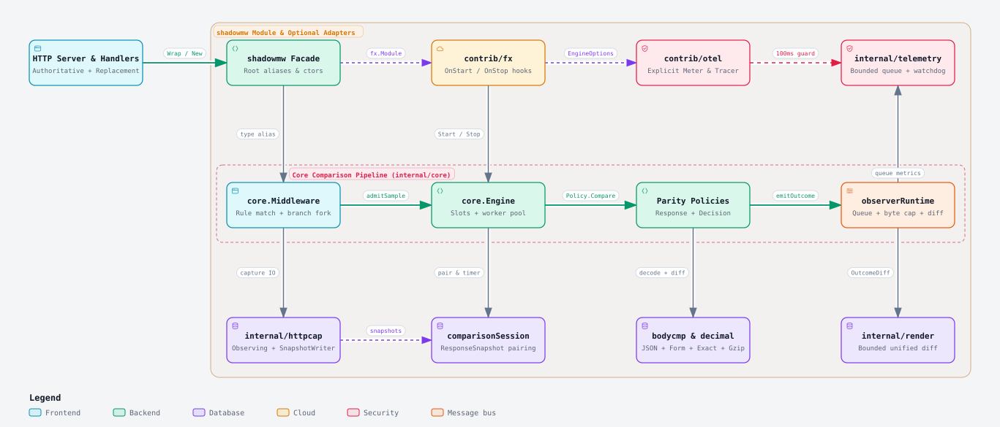
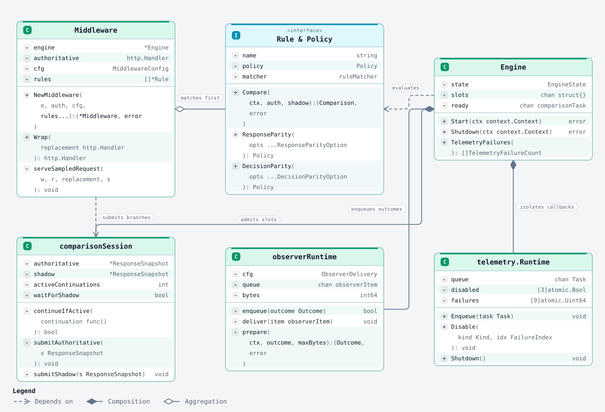
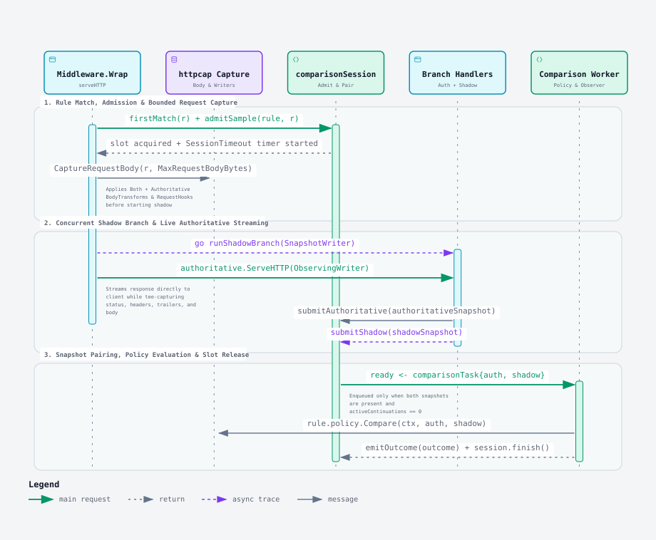
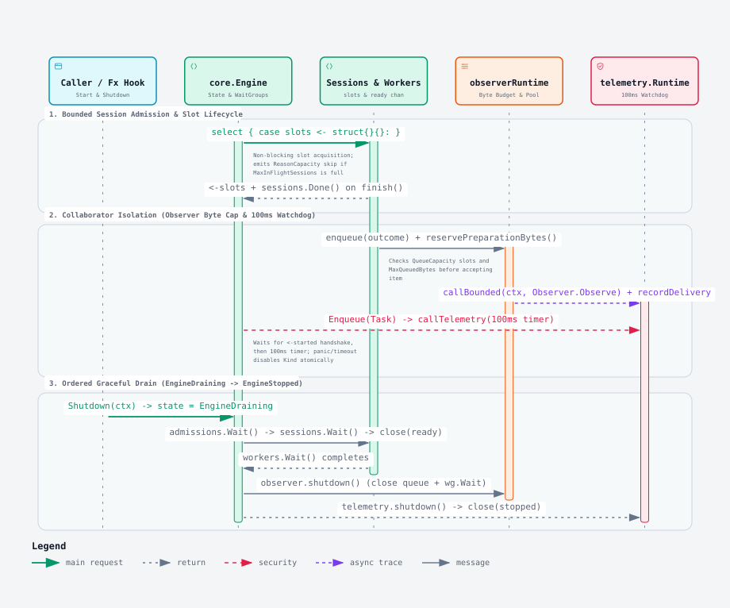

# shadowmw — Architecture Walkthrough

Bounded HTTP shadow comparison library for Go (`github.com/sergeybataev/shadowmw` @ [`main`](../shadowmw.go)).

- **Single-File HTML Walkthrough**: [`./walkthrough.html`](./walkthrough.html)
- **Interactive Archify Viewers**:
  - [`01-components.html`](./interactive/01-components.html) — Package & Runtime Component Architecture
  - [`02-types.html`](./interactive/02-types.html) — Core Types, Interfaces & Collaborator Contracts
  - [`03-request-flow.html`](./interactive/03-request-flow.html) — Sampled HTTP Request Execution & Comparison Pipeline
  - [`04-concurrency-shutdown.html`](./interactive/04-concurrency-shutdown.html) — Bounded Concurrency, Watchdog Isolation & Graceful Drain

---

## 1. Package & Runtime Component Boundaries

`shadowmw` exposes a thin, zero-dependency root facade ([`shadowmw.go`](../shadowmw.go#L1-L593)) over [`internal/core`](../internal/core/engine.go#L1-L360), while keeping optional framework integrations ([`contrib/fx`](../contrib/fx/fx.go#L1-L36) and [`contrib/otel`](../contrib/otel/otel.go#L20-L125)) in separate Go modules. At runtime, [`Middleware`](../internal/core/middleware.go#L84-L140) intercepts finite HTTP/1.x requests, routes matched samples through [`Engine`](../internal/core/engine.go#L136-L291) and its [`Policy`](../internal/core/rule.go#L14-L17) evaluators ([`ResponseParity`](../internal/core/parity.go#L64-L83) and [`DecisionParity`](../internal/core/decision.go#L20-L31)), and isolates outcome delivery ([`observerRuntime`](../internal/core/observer.go#L336-L375)) and telemetry callbacks ([`internal/telemetry`](../internal/telemetry/telemetry.go#L49-L150)) behind bounded queues and watchdog timers.

<picture>
  <source media="(prefers-color-scheme: dark)" srcset="./assets/diagrams/01-components-dark.svg">
  <source media="(prefers-color-scheme: light)" srcset="./assets/diagrams/01-components-light.svg">
  
</picture>

**[Interactive HTML](./interactive/01-components.html)** · **[Dark SVG](./assets/diagrams/01-components-dark.svg)** · **[Light SVG](./assets/diagrams/01-components-light.svg)** · **[Dark 2x PNG](./assets/diagrams/01-components-dark.png)** · **[Light 2x PNG](./assets/diagrams/01-components-light.png)**

### Source Pointers
- [`shadowmw.go:1-593`](../shadowmw.go#L1-L593) — Public type aliases, constants, and constructors re-exported from `internal/core`
- [`internal/core/middleware.go:84-273`](../internal/core/middleware.go#L84-L273) — `Middleware`, `NewMiddleware`, `Wrap`, and `serveHTTP` / `serveSampledRequest`
- [`internal/core/engine.go:136-360`](../internal/core/engine.go#L136-L360) — `Engine` lifecycle (`Start`, `Shutdown`, `drain`) and comparison worker pool
- [`internal/bodycmp/bodycmp.go:12-125`](../internal/bodycmp/bodycmp.go#L12-L125) & [`internal/decimal/decimal.go:1-52`](../internal/decimal/decimal.go#L1-L52) — Content-Encoding decompression, JSON/Form/Exact comparators, and arbitrary-precision decimal equality
- [`contrib/fx/fx.go:1-36`](../contrib/fx/fx.go#L1-L36) & [`contrib/otel/otel.go:20-125`](../contrib/otel/otel.go#L20-L125) — Optional Uber Fx lifecycle module and explicit-provider OpenTelemetry adapter

> [!TIP]
> **Current vs. Suggestion**: Currently, `Middleware.firstMatch` ([`internal/core/middleware.go:746-769`](../internal/core/middleware.go#L746-L769)) evaluates all rules linearly on every matched request solely to log a warning when `matches > 1`. For deployments with larger rule sets and disjoint matchers, short-circuiting after the first match (or detecting overlap at construction time for static path/method rules) would avoid evaluating remaining regex/predicate matchers on every request.

---

## 2. Core Types, Interfaces & Collaborator Contracts

All domain state crossing goroutine boundaries is either immutable at construction (`Middleware`, `Rule`, `Policy`) or defensively cloned into detached value snapshots (`ResponseSnapshot`, `BodyRepresentation`, `Outcome`). Per-sample coordination is encapsulated inside `comparisonSession`, while external collaborators (`Observer`, `Instrumentation`, `Tracing`, `slog.Logger`) are invoked behind bounded runtime wrappers.

<picture>
  <source media="(prefers-color-scheme: dark)" srcset="./assets/diagrams/02-types-dark.svg">
  <source media="(prefers-color-scheme: light)" srcset="./assets/diagrams/02-types-light.svg">
  
</picture>

**[Interactive HTML](./interactive/02-types.html)** · **[Dark SVG](./assets/diagrams/02-types-dark.svg)** · **[Light SVG](./assets/diagrams/02-types-light.svg)** · **[Dark 2x PNG](./assets/diagrams/02-types-dark.png)** · **[Light 2x PNG](./assets/diagrams/02-types-light.png)**

### Source Pointers
- [`internal/core/rule.go:14-127`](../internal/core/rule.go#L14-L127) — `Policy` interface, `Comparison`, `Difference`, and immutable `Rule` builder
- [`internal/core/parity.go:64-380`](../internal/core/parity.go#L64-L380) & [`internal/core/decision.go:20-274`](../internal/core/decision.go#L20-L274) — `responseParityPolicy` and `decisionParityPolicy` implementations
- [`internal/core/snapshot.go:63-188`](../internal/core/snapshot.go#L63-L188) — `BodyRepresentation` and `ResponseSnapshot` defensive cloning and byte accounting
- [`internal/core/engine.go:760-1171`](../internal/core/engine.go#L760-L1171) — `comparisonSession` state machine, continuation tracking, and snapshot pairing
- [`internal/core/observer.go:156-199`](../internal/core/observer.go#L156-L199), [`336-539`](../internal/core/observer.go#L336-L539) — `Observer`, `ObserverDelivery`, and `observerRuntime`
- [`internal/core/instrumentation.go:41-164`](../internal/core/instrumentation.go#L41-L164), [`294-439`](../internal/core/instrumentation.go#L294-L439) & [`internal/telemetry/telemetry.go:49-209`](../internal/telemetry/telemetry.go#L49-L209) — `Instrumentation`, `Tracing`, `SanitizeMeasurement`, and `telemetry.Runtime`

> [!TIP]
> **Current vs. Suggestion**: Currently, `ResponseSnapshot.Body()` and `Outcome` accessors allocate fresh defensive slices on every call ([`internal/core/snapshot.go:74-81`](../internal/core/snapshot.go#L74-L81), [`116`](../internal/core/snapshot.go#L116), [`internal/core/observer.go:116-154`](../internal/core/observer.go#L116-L154)). When `OutcomeFull` is used with trusted in-process observers, providing a read-only reader (`bytes.NewReader`) could reduce heap allocations on large bodies.

---

## 3. Sampled HTTP Request Execution & Comparison Pipeline

When a request arrives at `Middleware.Wrap(replacement)`, unmatched requests go straight to `replacement`. Matched requests are checked for finite HTTP/1.x compatibility (`httpcap.UnsupportedRequest`) and admitted via `Engine.admitSample`. Admitted samples capture the request body up to `MaxRequestBodyBytes`, prepare branch customizations, spawn the shadow branch goroutine against an in-memory `SnapshotWriter`, and stream the authoritative response directly to the client through `ObservingWriter`.

<picture>
  <source media="(prefers-color-scheme: dark)" srcset="./assets/diagrams/03-request-flow-dark.svg">
  <source media="(prefers-color-scheme: light)" srcset="./assets/diagrams/03-request-flow-light.svg">
  
</picture>

**[Interactive HTML](./interactive/03-request-flow.html)** · **[Dark SVG](./assets/diagrams/03-request-flow-dark.svg)** · **[Light SVG](./assets/diagrams/03-request-flow-light.svg)** · **[Dark 2x PNG](./assets/diagrams/03-request-flow-dark.png)** · **[Light 2x PNG](./assets/diagrams/03-request-flow-light.png)**

### Source Pointers
- [`internal/core/middleware.go:196-273`](../internal/core/middleware.go#L196-L273) — `serveHTTP` and `serveSampledRequest` admission, body capture, and branch dispatch
- [`internal/core/middleware.go:275-395`](../internal/core/middleware.go#L275-L395) — `prepareAuthoritativeExecution` and background `runShadowBranch`
- [`internal/core/middleware.go:397-468`](../internal/core/middleware.go#L397-L468) — `executeAuthoritativeBranch` with live SSE (`text/event-stream`) skip detection and transport-failure checks
- [`internal/httpcap/response.go:20-187`](../internal/httpcap/response.go#L20-L187) — `SnapshotWriter` (shadow in-memory buffer) and `ObservingWriter` (authoritative tee writer)
- [`internal/core/engine.go:362-425`](../internal/core/engine.go#L362-L425) — `Engine.process` worker execution, `ComparisonTimeout` enforcement, and `emitOutcome`

> [!TIP]
> **Current vs. Suggestion**: Currently, `prepareCommonBody` and `prepareAuthoritativeBody` ([`internal/core/middleware.go:251-266`](../internal/core/middleware.go#L251-L266)) run synchronously before `startShadowBranch` is invoked so common body transforms are shared. When `Customizations.Both` is empty, starting the shadow goroutine immediately after `CaptureRequestBody` would allow authoritative and shadow request customizations to run in parallel.

---

## 4. Bounded Concurrency, Watchdog Isolation & Graceful Drain

`Engine` enforces strict non-blocking bounds across every concurrent stage: a semaphore channel (`slots`, sized to `MaxInFlightSessions`) caps active sessions; `observerRuntime` enforces both item slots (`QueueCapacity`) and byte reservations (`MaxQueuedBytes`); and `telemetry.Runtime` runs every instrumentation, tracing, and logging callback under a 100ms post-scheduling watchdog that permanently disables any panicking or timed-out collaborator kind. During `Shutdown(ctx)`, `Engine.drain()` drains admissions, active sessions, comparison workers, observer workers, and telemetry workers in strict dependency order.

<picture>
  <source media="(prefers-color-scheme: dark)" srcset="./assets/diagrams/04-concurrency-shutdown-dark.svg">
  <source media="(prefers-color-scheme: light)" srcset="./assets/diagrams/04-concurrency-shutdown-light.svg">
  
</picture>

**[Interactive HTML](./interactive/04-concurrency-shutdown.html)** · **[Dark SVG](./assets/diagrams/04-concurrency-shutdown-dark.svg)** · **[Light SVG](./assets/diagrams/04-concurrency-shutdown-light.svg)** · **[Dark 2x PNG](./assets/diagrams/04-concurrency-shutdown-dark.png)** · **[Light 2x PNG](./assets/diagrams/04-concurrency-shutdown-light.png)**

### Source Pointers
- [`internal/core/engine.go:250-285`](../internal/core/engine.go#L250-L285), [`339-352`](../internal/core/engine.go#L339-L352) — `Engine.Shutdown` idempotent state transition and 5-stage `drain()` sequence
- [`internal/core/engine.go:451-506`](../internal/core/engine.go#L451-L506), [`848-872`](../internal/core/engine.go#L848-L872), [`1060-1171`](../internal/core/engine.go#L1060-L1171) — Non-blocking slot acquisition, `activeContinuations` guard, and `finish()` slot release
- [`internal/core/observer.go:384-539`](../internal/core/observer.go#L384-L539), [`615-644`](../internal/core/observer.go#L615-L644), [`692-719`](../internal/core/observer.go#L692-L719) — Dual slot/byte admission, `reservePreparationBytes`, timeout cleanup goroutine, and `recordAbandoned`
- [`internal/telemetry/telemetry.go:80-209`](../internal/telemetry/telemetry.go#L80-L209) — `callTelemetry` goroutine scheduling handshake (`<-started`), 100ms watchdog timer, and atomic collaborator circuit-breaking

> [!TIP]
> **Current vs. Suggestion**: Currently, `telemetry.Runtime` ([`internal/telemetry/telemetry.go:183-209`](../internal/telemetry/telemetry.go#L183-L209)) and `telemetryRuntime.startSpan` ([`internal/core/instrumentation.go:339-383`](../internal/core/instrumentation.go#L339-L383)) spawn a short-lived goroutine and `time.NewTimer(100ms)` per callback invocation to enforce the 100ms watchdog after scheduling. For high-throughput metrics/logging, running a persistent worker goroutine supervised by a watchdog monitor (spawning a replacement worker only when a callback actually stalls or panics) would eliminate per-measurement goroutine and timer allocations.
